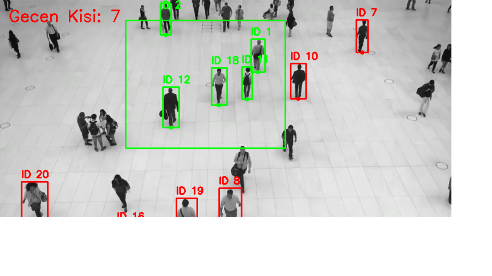

# Bölge İçi Kişi Sayma (Region Person Counter)

YOLO11 ve nesne takibi kullanarak bir videoda belirlenen dikdörtgen bölgeye giren kişileri sayan Python uygulaması.

## Özellikler

- YOLO11n ile gerçek zamanlı kişi tespiti
- Her kişiye takip ID'si atanır, aynı kişi bir kez sayılır
- Kişi bölgenin içindeyse kutusu **yeşil**, dışındaysa **kırmızı** görünür
- Bölgede biri varsa bölge çerçevesi de yeşile döner
- Ekranda bölgeye giren toplam kişi sayısı gösterilir





## Nasıl Çalışır?

1. Her karede kişiler tespit edilir ve takip edilir.
2. Her kişinin kutusunun **alt-orta noktası** (ayak noktası) hesaplanır.
3. Bu nokta dikdörtgen bölgenin içindeyse kişi "içeride" sayılır ve ID'si sayaç kümesine eklenir.

## Kurulum

```bash
git clone https://github.com/BySweK/region-person-counter.git
cd region-person-counter
pip install -r requirements.txt
```

## Kullanım

1. Kendi videonu `Videolar/` klasörüne koy (bu klasör repoya dahil değildir).
2. `main2.py` içindeki `VIDEO_YOLU` değişkenini kendi videonun yoluna göre düzenle.
3. Çalıştır:

```bash
python main2.py
```

Çıkmak için `q` tuşuna bas. YOLO model dosyası (`yolo11n.pt`) ilk çalıştırmada otomatik indirilir.

## Bölgeyi Değiştirme

Bölge, kare boyutuna oranla `main2.py` içinde tanımlıdır:

```python
x1 = int(w * 0.28)
x2 = int(w * 0.63)
y1 = int(h * 0.08)
y2 = int(h * 0.58)
```

Değerleri değiştirerek bölgeyi kendi videona göre ayarlayabilirsin.

## Kullanılan Teknolojiler

- Python
- OpenCV
- Ultralytics YOLO11

## Lisans

Ultralytics YOLO, AGPL-3.0 lisansıyla dağıtılmaktadır. Bu proje öğrenme amaçlı hazırlanmıştır.
